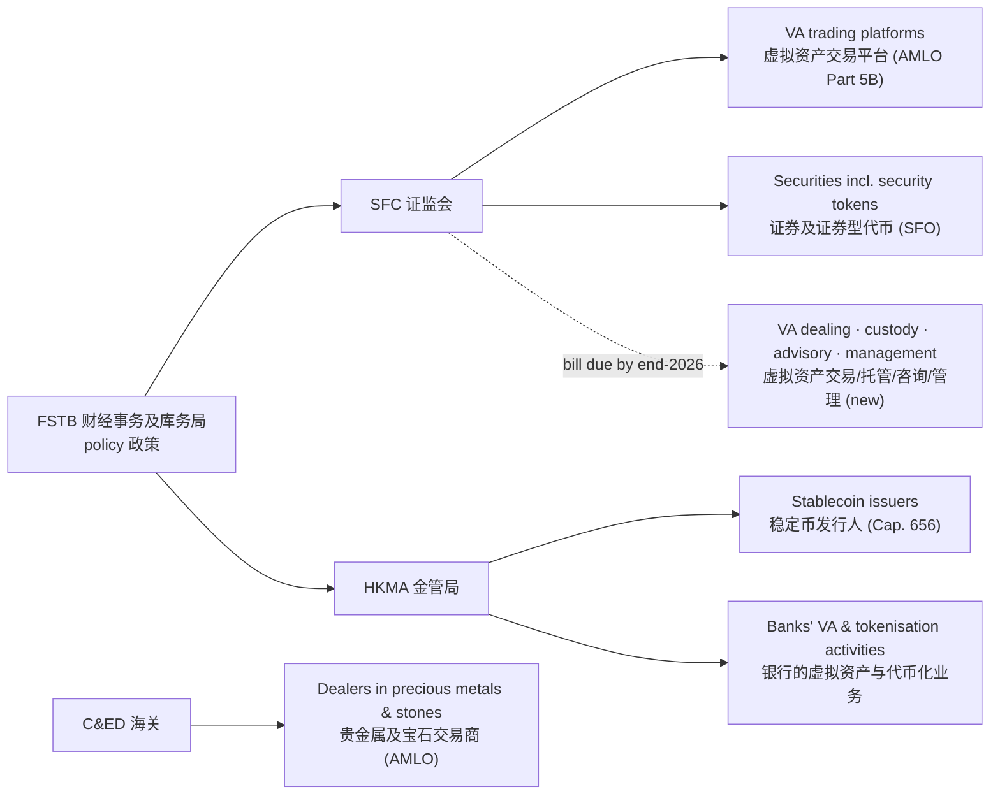

# Hong Kong Virtual Asset Regulation Notes · 香港虚拟资产监管笔记

Bilingual study notes on how Hong Kong regulates virtual assets, stablecoins, tokenisation and tokenised gold, written from a practitioner's point of view and linked to primary and professional sources.

中英双语的香港虚拟资产监管学习笔记，覆盖交易平台、稳定币、新的四类牌照、代币化和黄金代币化。每条事实都附出处，尽量引用监管机构原文或专业律所的解读。

> **Last reviewed 最后核对：2026-10-23.** These notes are a personal study resource, not legal advice. Rules change quickly; always check the regulator's current text. 本笔记仅为个人学习整理，不构成法律意见。

## Regulatory map 监管地图

| Activity 业务 | Regime 制度 | Regulator 监管机构 | Status 状态 (Oct 2026) |
|---|---|---|---|
| Operating a VA exchange 经营虚拟资产交易所 | AMLO Part 5B VATP licence | SFC | In force since 1 Jun 2023; 13 licensed platforms |
| Issuing fiat-referenced stablecoins 发行法币稳定币 | Stablecoins Ordinance (Cap. 656) | HKMA | In force since 1 Aug 2025; first 2 licences 10 Apr 2026 |
| VA dealing / OTC 虚拟资产交易（场外） | New AMLO licence | SFC | Consultation concluded Dec 2025; bill due by end-2026 |
| VA custody 虚拟资产托管 | New AMLO licence | SFC | As above |
| VA advisory / management 虚拟资产咨询/管理 | New AMLO licences | SFC | Consultation concluded May 2026; bill due by end-2026 |
| Tokenised securities and funds 代币化证券与基金 | SFO, existing licences and product authorisation | SFC | In force; 13 tokenised retail products (Mar 2026) |
| Dealing in physical gold 实物黄金交易 | DPMS registration (Category A / B) | C&ED | In force since 2023 |

## Contents 目录

1. [Regulatory map and principles 监管全景与原则](notes/01-regulatory-map.md)
2. [Virtual asset trading platforms 虚拟资产交易平台](notes/02-vatp.md)
3. [Stablecoins 稳定币](notes/03-stablecoins.md)
4. [The four new licensing regimes 四类新牌照](notes/04-new-licensing-regimes.md)
5. [Tokenisation 代币化](notes/05-tokenisation.md)
6. [Precious metals and the gold hub 贵金属与黄金中心](notes/06-precious-metals-and-gold.md)
7. [Timeline 时间线](notes/07-timeline.md)
8. [Glossary 术语表](notes/glossary.md)

## How these notes are maintained 维护方式

- Each note states facts with a source link and a date. 每条事实都附出处和日期。
- Where a figure comes from a secondary source, the note says so. 引用二手资料时会注明。
- Pending items (bills, consultations) are marked as pending until the regulator publishes final text. 尚未落地的立法和咨询，会标明「待定」。

Corrections are welcome via issues. 欢迎通过 issue 指正。

## License

Text: [CC BY 4.0](https://creativecommons.org/licenses/by/4.0/).
